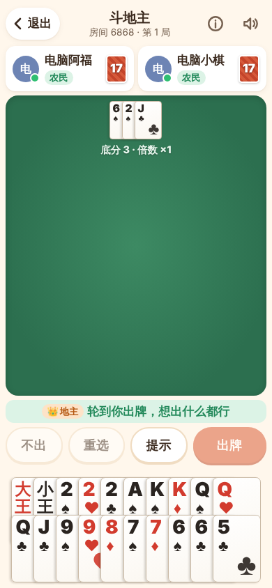
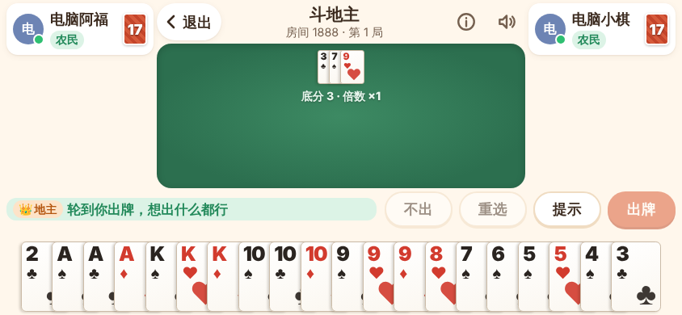
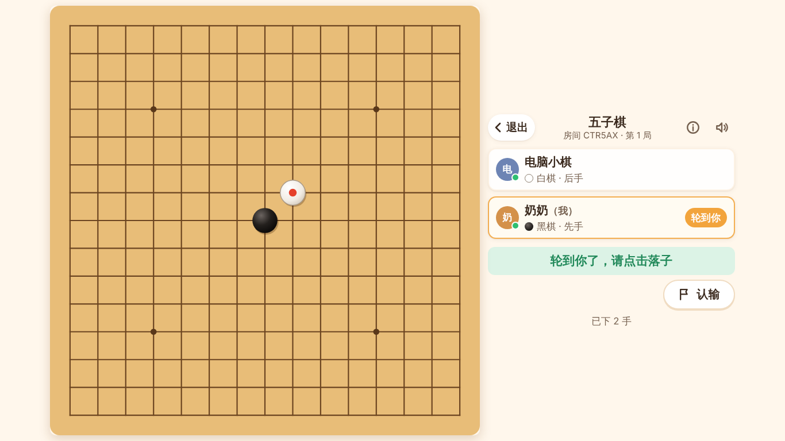

# 奶奶的游戏屋

家庭专用的网页小游戏平台（私人版 4399）。家里人用手机、平板或电脑打开网页，**不用注册**，把邀请链接发到家庭微信群，点开就能远程一起玩。

当前可玩：**五子棋**（联机 / 人机）、**斗地主**（三人联机，可让电脑补位）、**俄罗斯方块**、**贪吃蛇**（单机）。掼蛋、拖拉机开发中。详见 [docs/PROGRESS.md](docs/PROGRESS.md)。

线上地址（部署后）：**https://figri.me** ，邀请链接形如 `https://figri.me/r/8888`。部署见 [docs/DEPLOY.md](docs/DEPLOY.md)。

| 斗地主 竖屏 | 斗地主 横屏 | 五子棋 电脑 |
| --- | --- | --- |
|  |  |  |

## 快速开始（开发）

需要 Node.js 20+（推荐 22）。

```bash
npm install
npm run dev          # 同时启动服务端(3000) 和前端(5173)，浏览器打开 http://localhost:5173
```

同一局域网的手机可以访问 `http://电脑IP:5173` 测试。

## 常用命令

| 命令 | 作用 |
| --- | --- |
| `npm run dev` | 开发模式（前端热更新 + 服务端自动重启） |
| `npm test` | 单元测试 + 联机集成测试（Vitest，含真实 Socket 客户端） |
| `npm run test:e2e` | 构建后跑端到端测试（Playwright，两个独立浏览器会话 + 7 种屏幕尺寸） |
| `npm run typecheck` | TypeScript 类型检查 |
| `npm run build` | 构建：`dist/public`（前端）+ `dist/server.cjs`（单文件服务端，含全部依赖） |
| `npm start` | 运行构建产物（生产模式，自带静态文件服务） |

## 目录结构

```
packages/shared/      前后端共用：协议、游戏目录、规则引擎（纯函数，无 UI）
  src/game.ts           游戏模块接入规范 GameEngine
  src/protocol.ts       联机协议（事件名、快照结构、错误码）
  src/catalog.ts        大厅游戏目录
  src/games/gomoku/     五子棋规则引擎 + 电脑玩家
  src/games/doudizhu/   斗地主牌型、规则引擎、提示与电脑玩家
  src/games/tetris|snake/ 单机游戏逻辑（纯函数）
server/               Node.js + Socket.IO 权威服务端
  src/rooms.ts          通用房间系统（所有游戏复用）
  src/app.ts            HTTP + Socket 网关、限流、持久化接线
client/               React + TypeScript + Vite 前端
  src/net/connection.ts 连接、断线重连、状态仓库
  src/pages/            大厅、加入页、等待房间、游戏外壳
  src/games/<id>/       各游戏界面（横竖屏两套排布）
e2e/                  Playwright 端到端测试
deploy/               服务器一键安装（setup-server.sh）与更新（update.sh）
docs/                 架构、部署、新增游戏指南、进度、交接文档
```

## 文档

- [架构设计](docs/ARCHITECTURE.md) —— 技术选型、联机与断线重连、防重复操作、信息隐藏
- [阿里云部署](docs/DEPLOY.md) —— 阿里云美国（硅谷）服务器 + figri.me，一条命令完成 HTTPS/WSS
- [新增游戏指南](docs/ADDING_A_GAME.md) —— 游戏模块接入规范与验收清单
- [开发进度](docs/PROGRESS.md)
- [交接文档](docs/HANDOFF.md) —— 给下一位开发者 / AI
